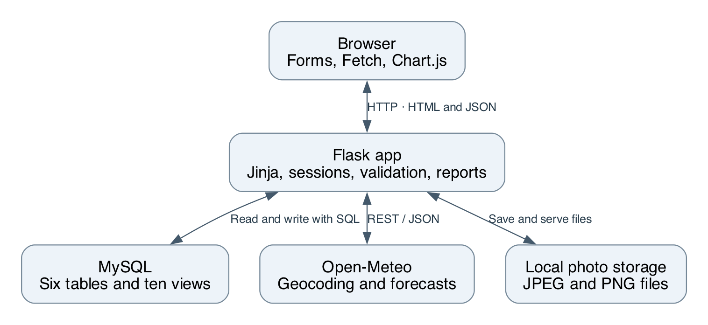

# How ExtraCredit works

ExtraCredit is a secondhand marketplace for Ontario Tech University students. Pickups happen at North Oshawa or Downtown Oshawa.

## Architecture diagram

## What each part does

- The **browser** shows listings, forms, photos, and reports. You can save a listing without reloading the page.
- **Flask** runs the app and checks who can see or change things.
- **MySQL** stores accounts, categories, listings, photo links, pickup requests, and saved weather. The report pages use ten saved queries.
- **Open-Meteo** provides the Oshawa forecast. The app saves it so students can see it again.

## Who can use it

- Guests see sign-in and registration. Students confirm an `@ontariotechu.net` address before they can see listings.
- Students can post an item or ask to pick one up at the campus shown on the listing.
- Admins can manage categories, view reports, and download CSV or PDF files.

The local demo uses sample accounts and saves email confirmation links in a folder.

[Setup instructions](../README.md#run-locally) · [Database diagram](database.md#entity-relationship-diagram) · [Demo screenshots](query-evidence.md)
